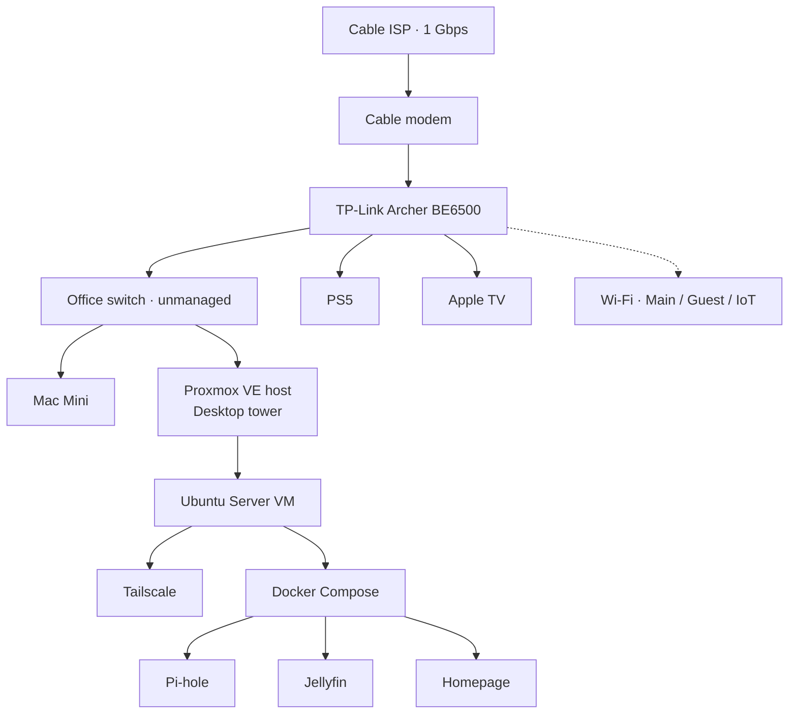

# Homelab

Self-hosted homelab on Proxmox VE, built on a repurposed desktop tower: virtualization, VPN remote access, network-wide DNS filtering, media streaming, and a unified dashboard.

**Status:** v1 in progress

## Network

## Stack

| Layer | Tool | Purpose |
|---|---|---|
| Hypervisor | Proxmox VE | Runs VMs, snapshots, web management |
| Services VM | Ubuntu Server 24.04 LTS | Hosts all services |
| Containers | Docker Compose | Isolated, reproducible services |
| Remote access | Tailscale | VPN with no exposed ports |
| DNS filtering | Pi-hole | Network-wide ad and tracker blocking |
| Media | Jellyfin | Self-hosted streaming |
| Dashboard | Homepage | One view of host, VMs, and services |
| Hardening | ufw, Proxmox firewall, fail2ban, unattended-upgrades | Layered host security |

## Hardware

| Part | Detail |
|---|---|
| Motherboard | Gigabyte GA-B250M-DS3H (micro-ATX, 4 DIMM slots, 6 SATA, 1 NVMe M.2) |
| CPU | Intel Pentium G4600, 2C/4T, HD 630 with Quick Sync |
| RAM | 16GB DDR4-2400 (2× 8GB, dual-channel) |
| Boot / VMs | NVMe SSD |
| Media | 1TB FireCuda |
| Spare / scratch | 1TB and 500GB 2.5" HDDs |
| Power supply | EVGA 450 BT |

- No discrete GPU: Jellyfin uses Quick Sync for hardware transcoding
- Lives in the office, wired through an unmanaged switch
- Estimated idle draw 25–35W (to be measured)

## Results

_Filled in as real numbers come in._

- DNS queries blocked by Pi-hole: —
- Devices protected: —
- Uptime: —
- Idle power draw: —

## Roadmap

- **v1:** Proxmox, Ubuntu VM, router hardening, Tailscale, Pi-hole, Jellyfin, Homepage
- **v2:** Home Assistant with IoT network segmentation (VLANs)
- **v3:** Backups, mirrored NAS drives, and an office rack with UPS

## Docs

- [Decision log](docs/decisions.md): why each tool and approach was chosen
- [Problems and fixes](docs/problems.md): what broke and how it was solved
- [Network](docs/network.md): topology, addressing, Wi-Fi segmentation
- [SSH setup](docs/ssh-setup.md)

## Screenshots

_Dashboard and Proxmox screenshots go in `screenshots/`._
