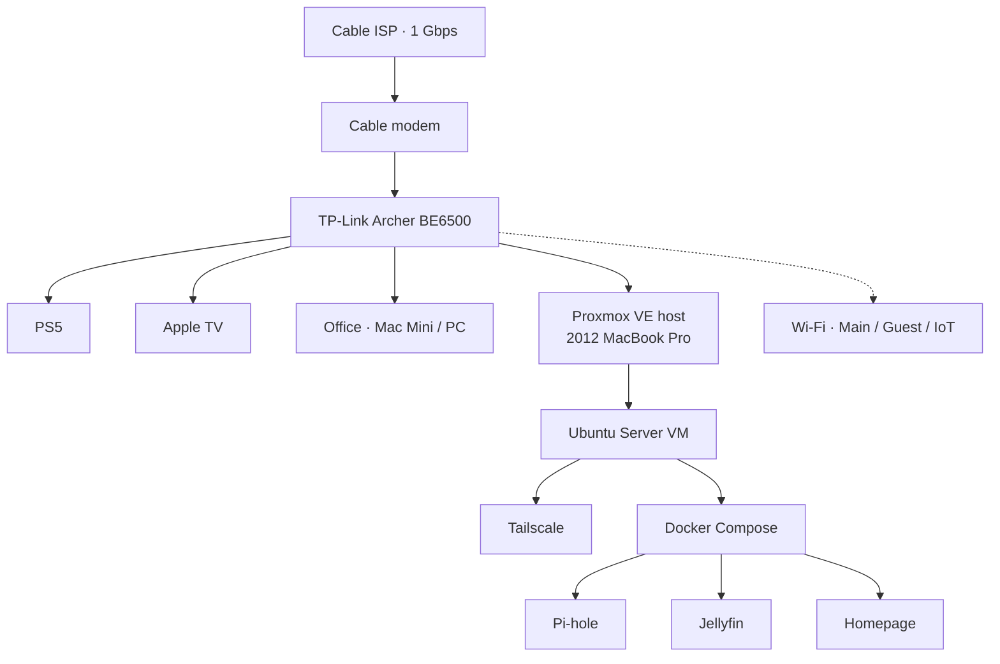

# Homelab

Self-hosted homelab on Proxmox VE, built on a repurposed 2012 MacBook Pro: virtualization, VPN remote access, network-wide DNS filtering, media streaming, and a unified dashboard.

**Status:** v1 in progress

## Network

## Stack

| Layer | Tool | Purpose |
|---|---|---|
| Hypervisor | Proxmox VE | Runs VMs, snapshots, web management |
| Services VM | Ubuntu Server 24.04 LTS | Hosts all services |
| Containers | Docker Compose | Isolated, reproducible services |
| Remote access | Tailscale | VPN with no exposed ports |
| DNS filtering | Pi-hole | Network-wide ad and tracker blocking |
| Media | Jellyfin | Self-hosted streaming |
| Dashboard | Homepage | One view of host, VMs, and services |
| Hardening | ufw, Proxmox firewall, fail2ban, unattended-upgrades | Layered host security |

## Hardware

- 2012 MacBook Pro (15"): quad-core i7, 16GB RAM, 500GB SSD
- Wired to the router; battery acts as a short UPS

## Results

_Filled in as real numbers come in._

- DNS queries blocked by Pi-hole: —
- Devices protected: —
- Uptime: —

## Roadmap

- **v1:** Proxmox, Ubuntu VM, router hardening, Tailscale, Pi-hole, Jellyfin, Homepage
- **v2:** Home Assistant with IoT network segmentation (VLANs)
- **v3:** Backups and redundant storage

## Docs

- [Decision log](docs/decisions.md): why each tool and approach was chosen
- [Problems and fixes](docs/problems.md): what broke and how it was solved
- [Network](docs/network.md): topology, addressing, Wi-Fi segmentation
- [SSH setup](docs/ssh-setup.md)

## Screenshots

_Dashboard and Proxmox screenshots go in `screenshots/`._
