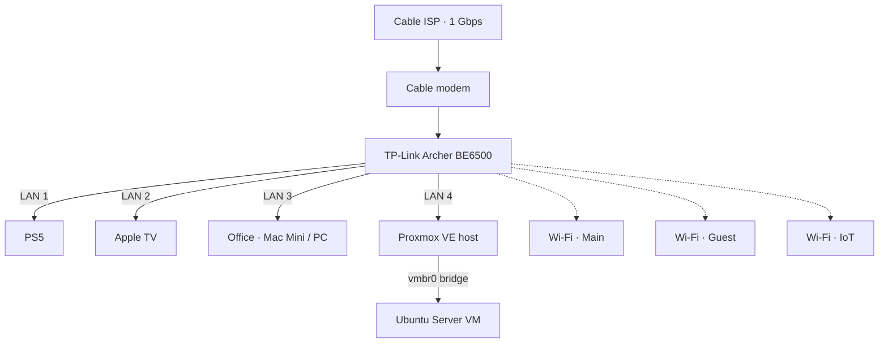

# Network

## Topology

All four router LAN ports are in use; any new wired device needs a switch.

## Addressing

Fixed addresses only where other devices need to find them, managed as DHCP reservations on the router.

| Device | Connection | IP |
|---|---|---|
| Router | — | |
| Proxmox host | Ethernet (LAN 4) | |
| Ubuntu VM | Proxmox bridge | |

Everything else uses normal DHCP.

## DNS

- Router hands out Pi-hole (on the Ubuntu VM) as the DNS server
- Fallback DNS: Quad9 (9.9.9.9), so the house stays online if the server is down

## Wi-Fi Segmentation

| SSID | Purpose | Isolation |
|---|---|---|
| Main | Trusted devices | — |
| Guest | Visitors | Router client isolation |
| IoT | Smart devices | Router client isolation |

Guest and IoT share the main subnet; isolation is a router rule, not a VLAN. Real VLAN segmentation is planned for v2.

## Remote Access

Tailscale only. No ports are forwarded on the router.
