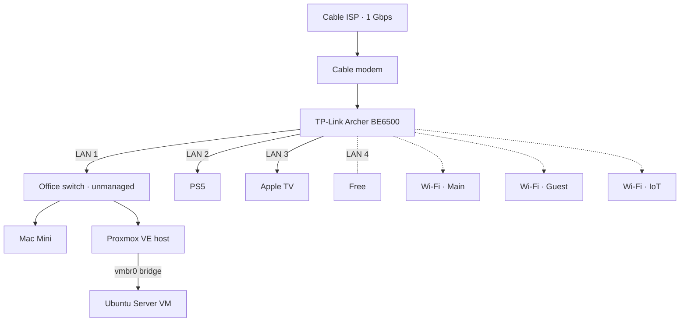

# Network

## Topology

LAN 1 is one long run to the office, where an unmanaged gigabit switch connects the Mac Mini and the server. They share that uplink, which is plenty for several 4K streams. LAN 4 is free.

An unmanaged switch can't do VLANs; it gets replaced with a managed one if v2 adds VLAN segmentation.

## Addressing

Fixed addresses only where other devices need to find them, managed as DHCP reservations on the router.

| Device | Connection | IP |
|---|---|---|
| Router | — | |
| Proxmox host | Ethernet (office switch, LAN 1) | |
| Ubuntu VM | Proxmox bridge | |

Everything else uses normal DHCP.

## DNS

- Router hands out Pi-hole (on the Ubuntu VM) as the **only** DNS server. No secondary, so nothing bypasses filtering.
- Tailscale clients use Pi-hole as DNS too.

### Manual fallback

If the server goes down and the internet stops working:

1. Open the router's admin page by IP address (works without DNS).
2. In the DHCP server settings, change the DNS server to Quad9 (9.9.9.9) and save.
3. Reconnect Wi-Fi on any device that doesn't pick it up.
4. When the server is back, switch DNS back to the VM's IP.

A second Pi-hole is the long-term fix.

## Wi-Fi Segmentation

| SSID | Purpose | Isolation |
|---|---|---|
| Main | Trusted devices | — |
| Guest | Visitors | Router client isolation |
| IoT | Smart devices | Router client isolation |

Guest and IoT share the main subnet; isolation is a router rule, not a VLAN. Real VLAN segmentation is planned for v2.

## Remote Access

Tailscale only. No ports are forwarded on the router.
